# Brisa Costera - Agencia de Viajes


Caso de estudio A (segundo corte) - Programación 1 (Java)

- **Autor:** Kevin Alejandro Barco Guerra
- **Universidad:** UNIAJC – Institución Universitaria Antonio José Camacho
- **Docente:** David Escobar Valencia

## 1. La empresa

Brisa Costera es una agencia de viajes hipotética con planes de playa en Colombia para familias, parejas y personas que viajan solas.

**Misión:** Acercar las playas del Caribe y el Pacífico colombiano a quienes quieren descansar, con planes sencillos de reservar, atención personalizada y tarifas claras.

**Visión:** Consolidarnos como la agencia preferida por familias y parejas para sus vacaciones en la costa, creciendo con la confianza de nuestros clientes.

**Qué resuelve el sistema:** el vendedor registra los datos del cliente, el tipo de maleta y las personas que viajan, calcula el valor del viaje, revisa la información y guarda un respaldo en TXT. Puede atender varios clientes seguidos.

| Maleta | Siglas | Tarifa por persona |
|---|---|---|
| Básica | MB | $ 285.325 |
| Premium | MP | $ 325.650 |

Valor del viaje = tarifa de la maleta × personas que viajan (el cliente cuenta como una persona).

## 2. Uso de inteligencia artificial

- **Nombre, misión y visión:** Claude propuso varias opciones y elegí "Brisa Costera".
- **Logo:** ChatGPT (versión gratuita). Generó 3 opciones y elegí una. Prompt usado:

```
Diseña el logo de una agencia de viajes colombiana llamada "Brisa Costera", especializada en planes de playa en Colombia (Caribe y Pacífico) para familias, parejas y personas que viajan solas. Estilo: ilustración vectorial plana, minimalista, cercana y amable. Ícono: olas simples con un sol bajo o una palmera pequeña, y una línea suave que sugiera la brisa, dentro de una forma redondeada. Colores: turquesa, azul mar, arena y un toque de coral, sobre fondo blanco. Texto: "Brisa Costera" en tipografía redondeada y legible y, debajo, en letra más pequeña, "Agencia de viajes". No incluyas personas, marcas ni logotipos existentes, ni fotografías. Formato cuadrado 1:1, centrado y en alta resolución. Dame 3 variantes distintas.
```

- **Requerimientos, historias de usuario, backlog y código:** me apoyé en Claude para redactar y para guiarme por bloques. Revisé, ajusté, ejecuté y probé todo.

## 3. Requerimientos

Cada requerimiento es un Issue del repositorio con su etiqueta.

| Funcionales | No funcionales | Dominio |
|---|---|---|
| [RF-01](../../issues/1) Menú principal | [RNF-01](../../issues/16) Formato del archivo de respaldo | [RD-01](../../issues/21) Protección de datos (Ley 1581 de 2012) |
| [RF-02](../../issues/2) Ingresar nombre | [RNF-02](../../issues/17) Claridad de los mensajes | [RD-02](../../issues/22) Cédula de 6 a 10 dígitos |
| [RF-03](../../issues/3) Ingresar cédula | [RNF-03](../../issues/18) Valores en pesos colombianos | [RD-03](../../issues/23) Tarifas de maleta |
| [RF-04](../../issues/4) Ingresar fecha del viaje | [RNF-04](../../issues/19) Manejo de errores del respaldo | [RD-04](../../issues/24) Precio claro (Ley 1480 de 2011) |
| [RF-05](../../issues/5) Ingresar destino | [RNF-05](../../issues/20) Comentarios del código | |
| [RF-06](../../issues/6) Elegir tipo de maleta | | |
| [RF-07](../../issues/7) Ingresar acompañantes | | |
| [RF-08](../../issues/8) Calcular valor del viaje | | |
| [RF-09](../../issues/9) Ver información del viaje | | |
| [RF-10](../../issues/10) Respaldo en TXT | | |
| [RF-11](../../issues/11) Cerrar factura con vacaciones | | |
| [RF-12](../../issues/12) Salir del sistema | | |
| [RF-13](../../issues/13) Opción no válida | | |
| [RF-14](../../issues/14) Aviso de datos faltantes | | |
| [RF-15](../../issues/15) Registrar fecha y hora | | |

El **RF-15** no estaba en el enunciado: lo agregué yo para que el respaldo muestre la fecha y la hora en que se generó.

## 4. Historias de usuario y backlog

Cada historia es un Issue con la estructura Como / Quiero / Para y enlaza a sus requerimientos con `#`.

| Identificador | Historia de usuario | Requerimientos | Prioridad |
|---|---|---|---|
| [HU-01](../../issues/25) | Registrar cliente | RF-02 a RF-05, RD-01, RD-02 | Alta |
| [HU-02](../../issues/26) | Elegir tipo de maleta | RF-06, RD-03 | Alta |
| [HU-03](../../issues/27) | Registrar acompañantes | RF-07 | Alta |
| [HU-04](../../issues/28) | Consultar valor del viaje | RF-08, RNF-03, RD-04 | Alta |
| [HU-05](../../issues/29) | Ver información de la reserva | RF-09, RF-14 | Media |
| [HU-06](../../issues/30) | Guardar respaldo | RF-10, RF-15, RNF-01, RNF-04 | Media |
| [HU-07](../../issues/31) | Atender a un cliente nuevo | RF-11 | Media |
| [HU-08](../../issues/32) | Salir del sistema | RF-12 | Baja |
| [HU-09](../../issues/33) | Usar el menú | RF-01, RF-13, RNF-02 | Alta |

Prioridad: **Alta** es lo necesario para hacer una reserva, **Media** completa el servicio y **Baja** es cerrar el programa. El RNF-05 es técnico, por eso no tiene historia.

Tablero: [Backlog Brisa Costera](https://github.com/users/kevinalejandro2025-oss/projects/1/views/1)

## 5. Paso a paso en GitHub

**1. Crear el repositorio**.

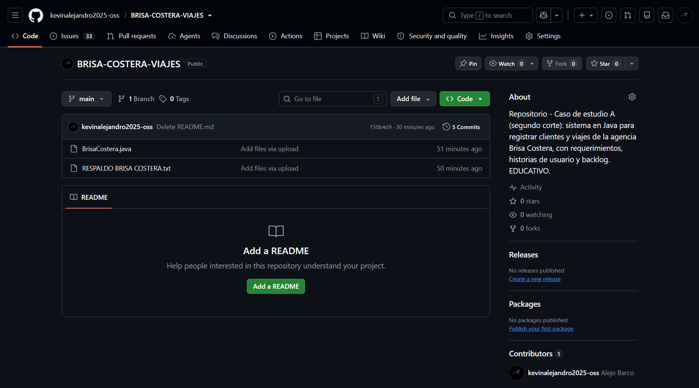

**2. Crear las etiquetas** en **Issues → Labels → New label**: Funcional, No Funcional, Dominio e Historia de usuario.

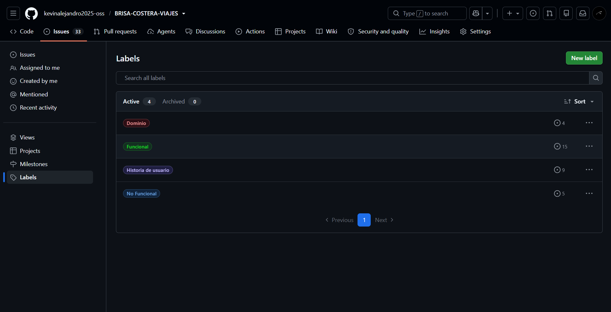

**3. Publicar los requerimientos** como Issues (**Issues → New issue**), uno por requisito, con su etiqueta.

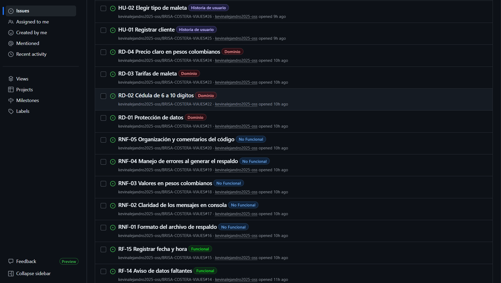

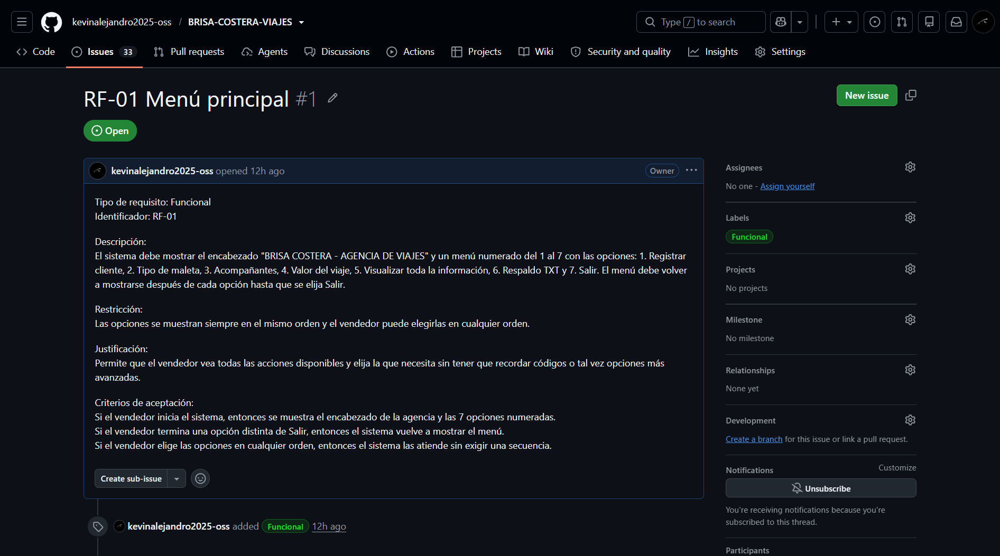

**4. Publicar las historias de usuario** como Issues con la etiqueta Historia de usuario. En "Requerimientos relacionados" se escribe el número de cada requisito con `#` (por ejemplo `RF-02 #2`).

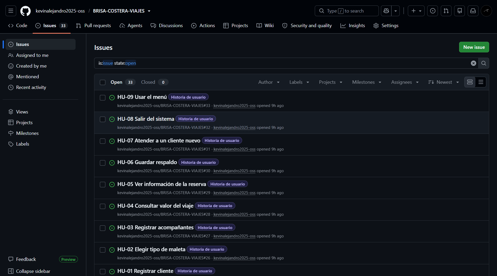

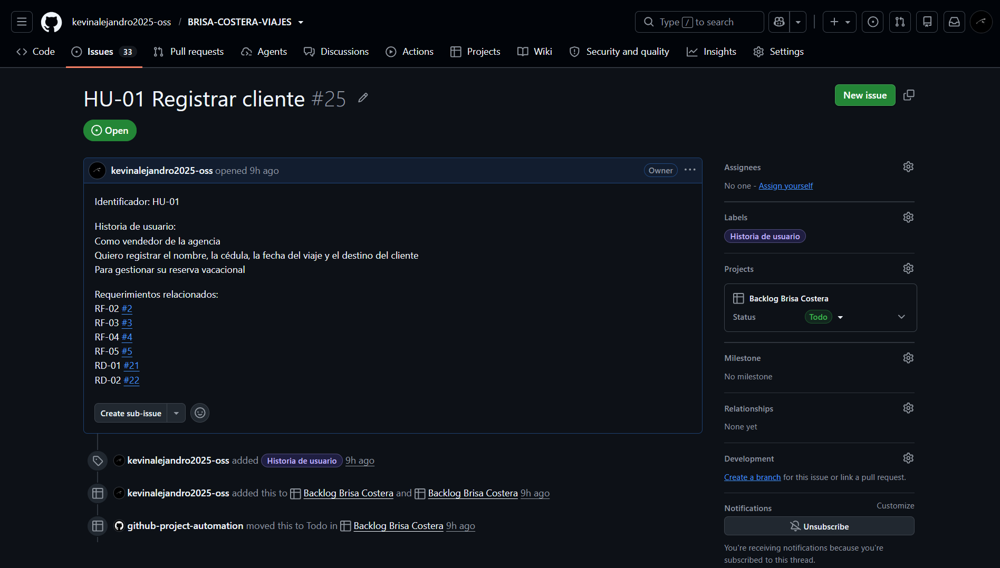

**5. Comprobar la trazabilidad:** al escribir `#2` en la historia, GitHub lo vuelve un enlace y el RF-02 muestra que la HU-01 lo menciona.

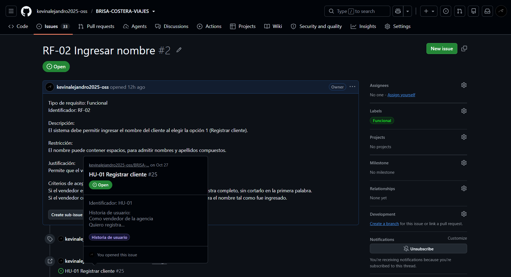

**6. Crear el tablero:** en **Projects → New project** con la plantilla **Board**, y agregar las 9 historias con **+ Add item**.

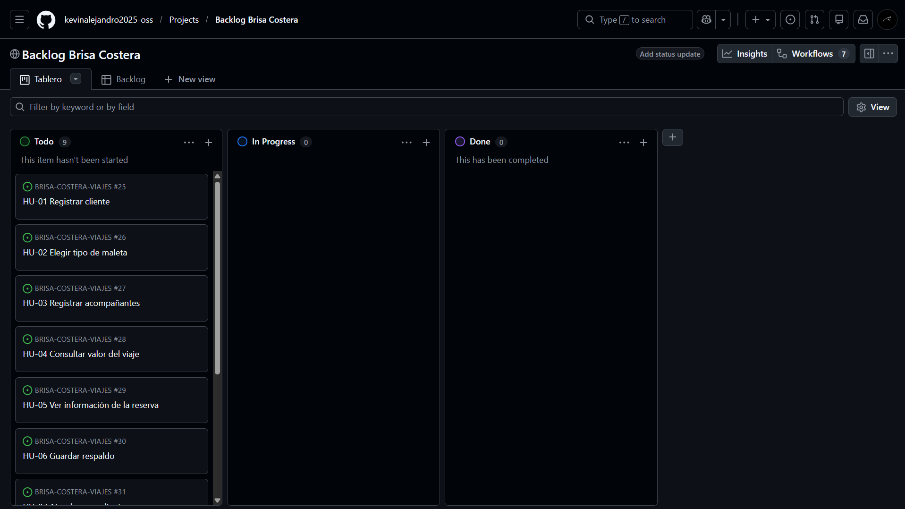

**7. Crear el backlog:** en la vista de tabla, agregar un campo **Prioridad** (Single select: Alta, Media, Baja), asignarlo a cada historia y agrupar con **View → Group by → Prioridad**.

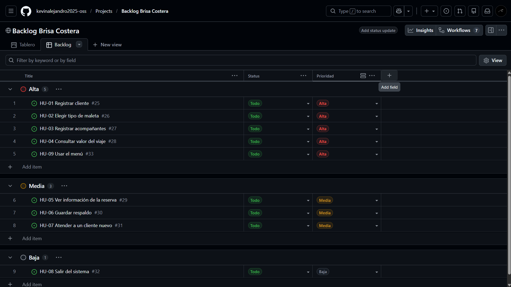

## 6. El algoritmo

El código está en [BrisaCostera.java](BrisaCostera.java). Se ejecuta con **Run** en Visual Studio Code (JDK 21) y el respaldo se crea como `RESPALDO BRISA COSTERA.txt` en la misma carpeta.

### Cómo funciona

Cuando el programa empieza, crea las variables del cliente vacías y muestra el menú.

- **El `while`** repite el menú una y otra vez hasta que el vendedor escoge la opción 7, que es salir.
- **El `switch`** mira qué número escogió el vendedor y hace lo de esa opción: registrar, maleta, personas, valor, ver información o respaldo. Si escribe un número que no está en el menú, el `default` le avisa.
- **Los `boolean`** funcionan como interruptores: empiezan apagados (`false`) y se encienden (`true`) cuando un dato se registra bien. Así, antes de calcular, mostrar o guardar, el programa revisa los interruptores y avisa qué falta.
- **Las validaciones con `if`** revisan que la cédula tenga de 6 a 10 dígitos, que la maleta sea MB o MP y que las personas sean más de 0.
- **"vacaciones":** después de cada opción del 1 al 6 el programa pregunta si se cierra la factura. Si se escribe `vacaciones`, se borran los datos y se apagan los interruptores para atender a otro cliente.
- **El respaldo** se crea con `FileWriter` y `BufferedWriter` dentro de un `try`. Si no se puede crear el archivo, el `catch` muestra el error y el programa sigue funcionando.

### Dónde está cada requerimiento en el código

| Requerimiento | Parte del código |
|---|---|
| RF-01 | `while` y menú |
| RF-02 a RF-05, RD-02 | `case 1` (la cédula se repite con un `while` hasta que tenga de 6 a 10 dígitos) |
| RF-06, RD-03 | `case 2` |
| RF-07 | `case 3` |
| RF-08, RD-04 | `case 4` |
| RF-09 | `case 5` |
| RF-10, RF-15, RNF-01 | `case 6` |
| RF-11 | `if` de "vacaciones" al final del `while` |
| RF-12 | `case 7` |
| RF-13 | `default` |
| RF-14 | Los `boolean` y los avisos de los `case 4`, `5` y `6` |
| RNF-03 | `formatopesos` |
| RNF-04 | `catch (IOException error)` |
| RD-01 | El TXT solo guarda datos de la reserva y "vacaciones" borra los del cliente |

## 7. Pruebas

Las pruebas se hicieron con datos de prueba. En algunas capturas la cédula aparece tapada para no publicarla. Cuando el sistema pregunta por "vacaciones" y no quiero cerrar la factura, respondo con una sola palabra, por ejemplo `seguir`.

| Prueba | Requisito | Qué se hace | Qué debe pasar |
|---|---|---|---|
| P01 | RF-01 | Iniciar el programa | Sale el menú con las 7 opciones |
| P02 | RF-14 | Elegir 5 y 6 sin datos | Avisa qué datos faltan |
| P03 | RF-13 | Elegir 9 | "OPCION NO VALIDA" y vuelve el menú |
| P04 | RF-02 a RF-05, RD-02 | Opción 1 con cédulas 99999, 10000000000 y 1234567890 | Las dos primeras dan error y la tercera se acepta |
| P05 | RF-06, RD-03 | Opción 2 con `mb` y luego `MB` | `mb` da error, `MB` se registra |
| P06 | RF-07 | Opción 3 con 0 y luego 4 | 0 da error, 4 se registra |
| P07 | RF-08, RNF-03 | Opción 4 con MB y 4 personas | Valor de $ 1.141.300,00 |
| P08 | RF-09 | Opción 5 | Se ven los siete datos |
| P09 | RF-10, RF-15 | Opción 6 y abrir el TXT | Se crea el archivo con la fecha y la hora al final |
| P10 | RNF-04 | Opción 6 con el TXT en solo lectura | "Acceso denegado" y el programa sigue |
| P11 | RF-11, RD-01 | Responder `vacaciones`, elegir 5 y registrar otro cliente con cédula de 10 dígitos | Factura cerrada, ya no están los datos anteriores y la cédula 9999999999 se acepta |
| P12 | RF-12 | Elegir 7 | Mensaje de despedida y termina |

**P01**
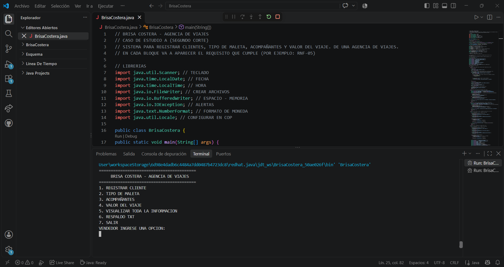

**P02**
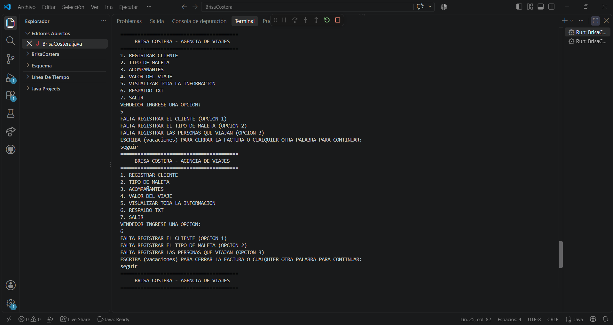

**P03**
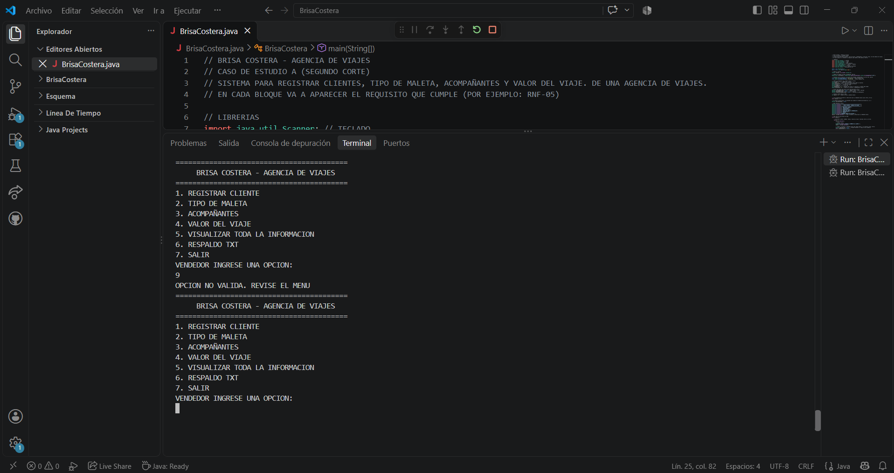

**P04**
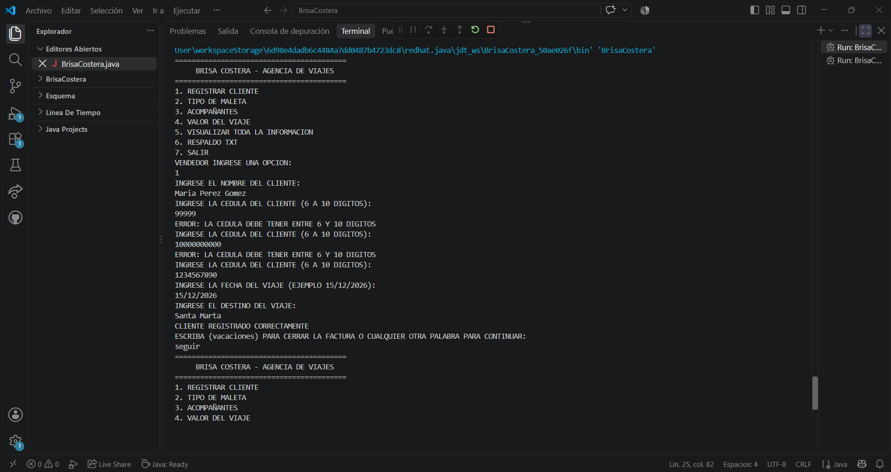

**P05**
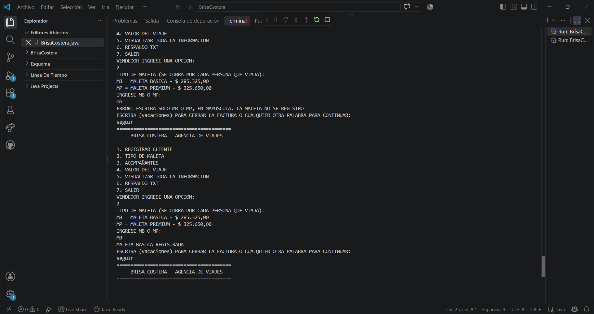

**P06**
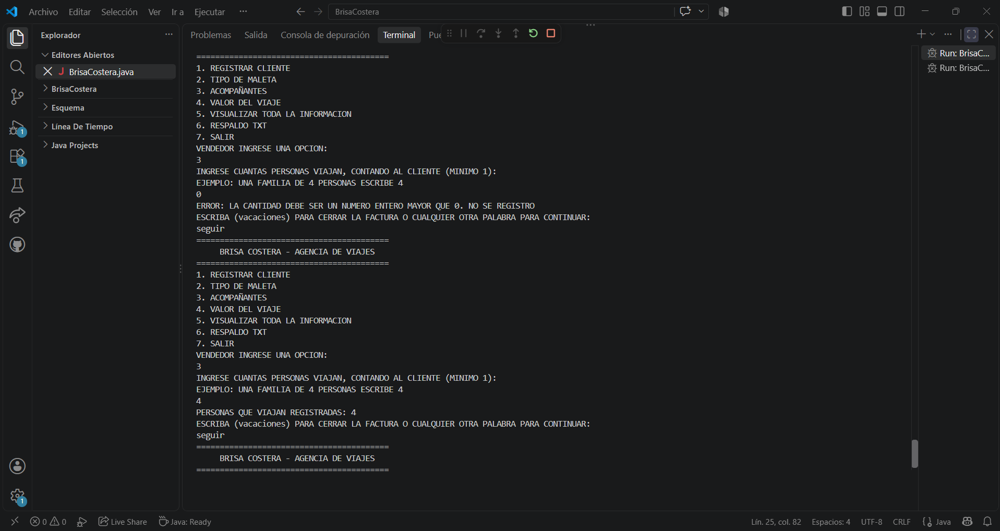

**P07**
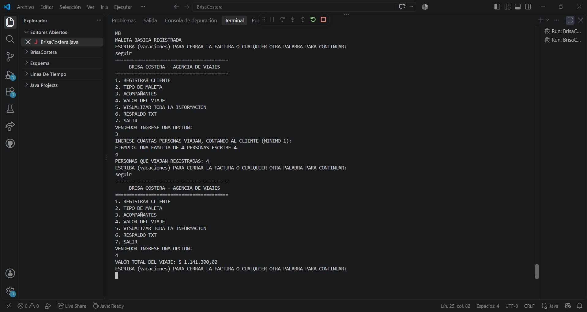

**P08**
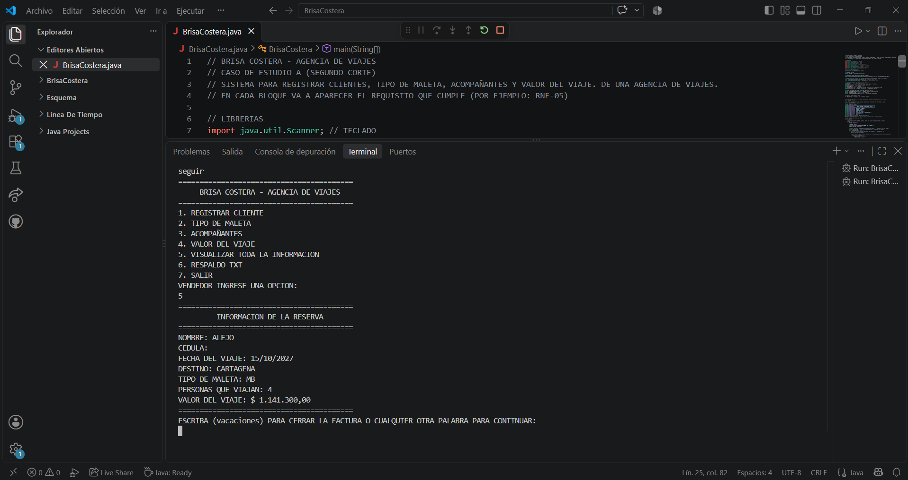

**P09**
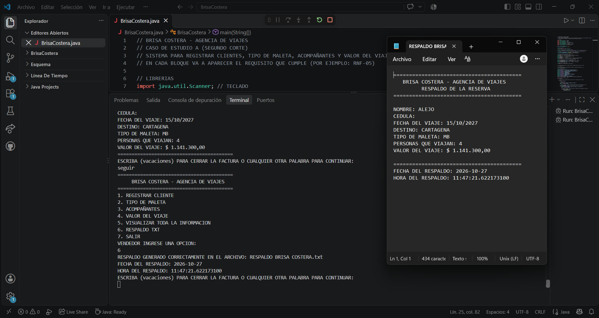

**P10**
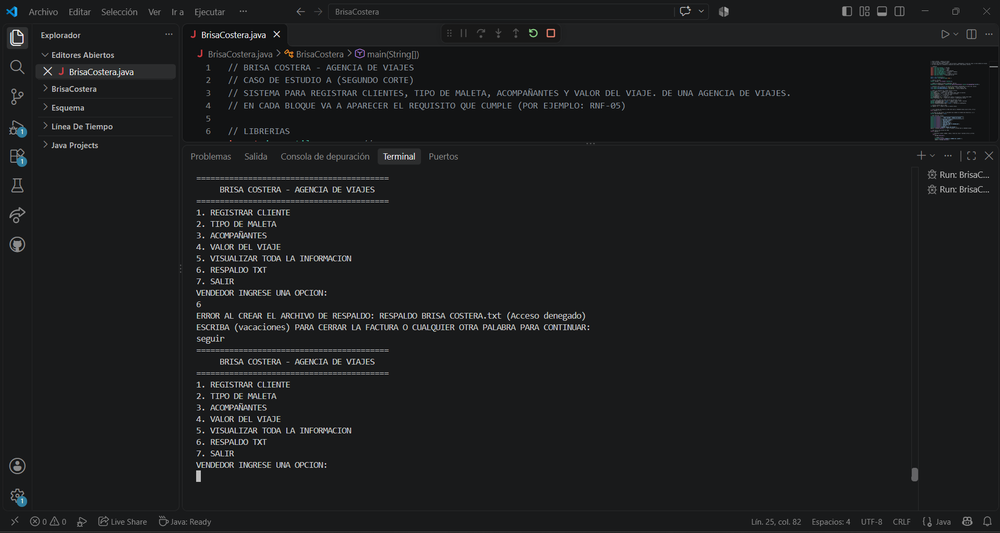

**P11**
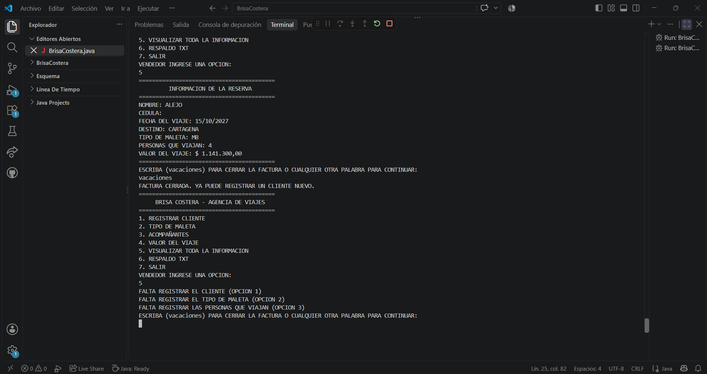
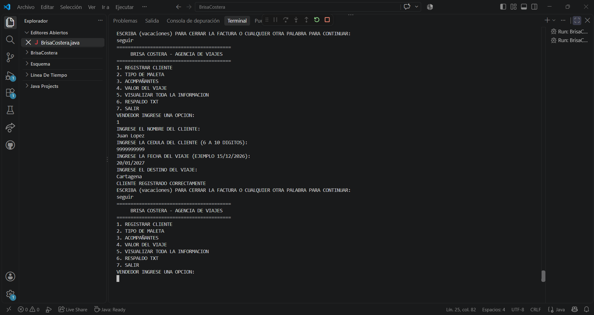

**P12**
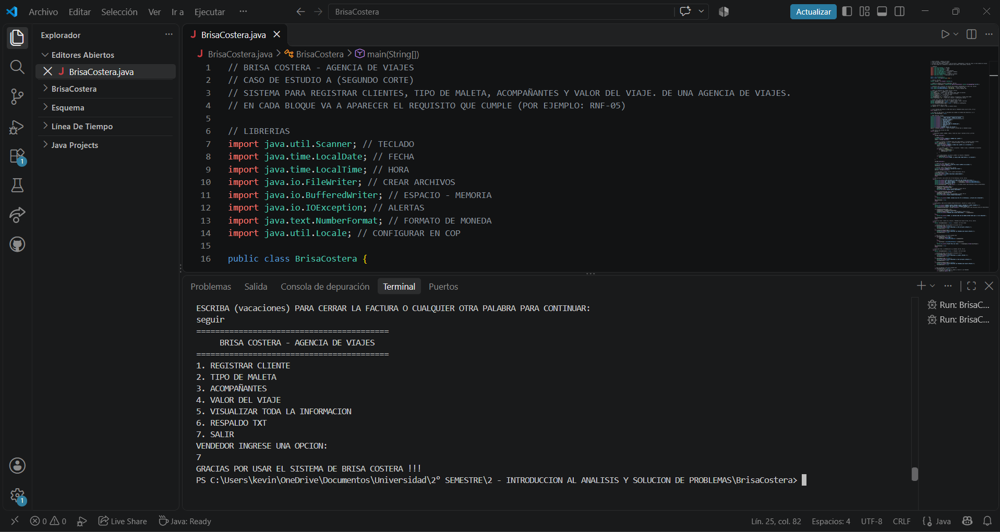


